# Measurements: where the detector, the strobe drift and length mode are weak

Re-run everything (about 35 min with 16 cores; CSVs, plots and
`out/summary.txt` with all numbers are rewritten):

```sh
CC=gcc sh tools/measure/run.sh          # or: sh tools/measure/run.sh plot
```

What's measured:

- **`m_detect.c`** runs `jni/pitch.c`.
- **`m_drift.c`** runs `jni/strobe.c`, with stubs for the JNI and drawing
  calls. It reads the drift the way `mixture.feed()` does: one reading per
  1024-sample buffer, summed until there are T usable seconds.
- **`siggen.h`** is a header-only, seeded synthesiser.
  - Pipes are exactly harmonic, with an attack time of 3 periods (15-250 ms),
    a chiff and room noise 50 dB down.
  - Optional extras: a phone-mic high-pass (24 dB/oct at 150 Hz), tremulant,
    a second pipe, and wind wander (AR(1) process).
- **`variants.py`** writes changed copies of `jni/*.c` into `build/`, so a
  proposed change can be measured next to the current code. The app code
  itself is not touched.
  - `pitch_halfband.c`: a 63-tap half-band filter replaces the 2:1
    decimation's average of each sample pair.
  - `pitch_focusnear.c`: `focus()` takes the nearest harmonic, not the
    strongest one.
  - `strobe_onset.c`: the drift settling restarts at each onset.

All signals are synthetic. Real pipes add pitch wander, unsteady wind and
room reflections. The `q3_drift_wind` plot shows the most important of these;
its size (0.5 c rms, 0.1 s) is an assumption. Recordings can be checked with
`tools/test_pitch file.wav`.

## Ranked recommendations

1. **`pitch.c focus()` picks a neighbouring partial (bug-level).**
   - **What goes wrong.** It takes the *strongest* harmonic within
     FOCUS_SPAN = 550 c of the expected partial. From the 3rd partial up, the
     neighbouring partials are closer than that: 3:4 is 498 c, 4:5 is 386 c,
     5:6 is 316 c.
   - **How often.** In a sounding mixture (8' ... 1/2', the other ranks ±3 c),
     the estimate is a fourth or fifth off at:
     - 18 of 61 keys for 2 2/3'
     - 38 for 2'
     - 60 for 1 3/5'
     - 34 for 1 1/3'
     - 46 for 1'
   - **Fix.** Take the harmonic *nearest* in cents to `focus_ratio*expect_hz`.
     With that, every failure left is a partial above MAX_PARTIAL, and
     `tools/test_pitch` still scores 537/537.
2. **The drift measurement starts on the pipe's attack ("cold").**
   - **What goes wrong.** DRIFT_SETTLE_TAUS settles only after
     `drift_reset()`. When the key is played after the row is set (the usual
     order: tap Measure, then play), the onset transient rings at the row
     frequency. That pulls the result towards "in tune".
   - **Size.** At T = 2 s and SNR 20 dB:
     - 8' to 1' rows: 0.26-0.30 c RMS (pipes ±20 c), up to 3.5 % of the
       offset.
     - Warm (pipe already sounding): 0.001-0.024 c.
   - **Fix.** Restart the settling at every onset: the block amplitude rising
     from below the gate, or more than doubling. That halves the error
     (8' 0.26 -> 0.12 c, 16' 0.11 -> 0.05 c) and costs 0.1-0.2 s.
   - **Better still.** Also skip about 0.2 s after an onset, or weight the
     blocks by amplitude.
3. **Replace the 2:1 decimation (an average of each sample pair) with a
   half-band FIR.**
   - **What goes wrong.** Aliases of partials above 11 kHz land in the
     0-9 kHz analysis band.
     - Reeds lose their estimate from A#6 to C8 (11 notes; confidence drops
       to 0.55-0.69, below MIN_CONF 0.7).
     - The missing-fundamental case fails from G#7 up.
     - An open flue at E6 is 2.2 c off. The alias of its 10th partial
       (8989 Hz) is matched as its 7th, so length mode shows "settled" at
       2.2 c wrong.
   - **Fix.** A 63-tap Blackman half-band filter (cut-off fs/4) fixes all of
     these:
     - reed 97/97 notes;
     - open flue 1-s error p95 <= 0.58 c everywhere (> 0.3 c only in the 32'
       octave).
   - **Cost.** About 1.4 M multiply-adds/s, or half that using the filter's
     zero taps.
4. **Raise MAX_PARTIAL from 9000 to about 10500 Hz (after item 3), or blank
   the rows above it.**
   - Strobe rows are drawn up to ORGAN_MAX_FREQ * 44100 = 11025 Hz, but the
     detector looks only below 9 kHz.
   - So focusing fails in a band where the row is still shown: 1' from D6,
     1 1/3' from G6, 1 3/5' from A#6, 1/2' from D5.
5. **Length mode trusts the detector path in the bass, where it has a fixed
   bias.**
   - **Bias.** The parabolic interpolation on 2.7 Hz bins leaves a bias that
     does not change from estimate to estimate:
     - stopped pipes: 0.9-1.5 c in the 32' octave, 0.4-0.8 c in the 16'
       octave;
     - open pipes: 0.2-0.6 c.
   - **Why it shows as settled.** The spread length mode tests (MAD) is only
     0.00-0.02 c. So `STABLE_CENTS = 1` says "settled" while the reading is
     1.5 c off (about 4.5 mm on the C of a 32' stopped rank).
   - **Fix.** Below about C2, use the drift path whenever possible: focus the
     pipe's own row automatically. That gives 0.02-0.04 c after 1 s.
   - **Or improve the detector itself.** Refine the frequency from the phase
     advance between successive FFTs (hop 2048), which has no such bias.
6. **Length display resolution should follow the pitch.**
   - **At the top.** "In tune" (0.0 mm, |dL| < 0.05 mm) covers:
     - ±1.1 c at C7 open / C6 stopped;
     - ±2.1 c at C8 open / C7 stopped;
     - ±4.2 c at C8 stopped.
   - **In the bass.** A 0.1 mm step is finer than a wandering pipe allows:
     2 sigma is 1.2 mm at C2 open with 0.5 c wander.
   - **Fix.** Show 0.01 mm when mm/cent < 0.1 (from about C6 open, C5
     stopped), and 1 mm when mm/cent > 1 (below about D2 open, D1 stopped).
     Alternatively, decide "in tune" by cents (|c| < 0.2) rather than by the
     rounded mm.
7. **MEASURE_SECONDS = 2.0 is about right, but for wind wander, not for
   noise.**
   - **Steady pipe, warm start.** RMS < 0.05 c is reached after:
     - 0.25-0.5 s for 8'-1' rows at SNR >= 10 dB (1 s at SNR 0 dB);
     - 0.75 s for 32' (2 s at SNR 0 dB).
   - **With 0.5 c rms wander** (correlation time 0.1 s), the error follows
     sigma*sqrt(2 tau/T): 0.17 c at 1 s, 0.15 c at 2 s, 0.12 c at 4 s.
   - **Recommendation.** Keep 2 s for rows of 8' and higher. Use 3 s for
     32'/16' rows: the settling already costs 32' C 1.7 s of wall time (3.7 s
     in total).
8. **A second pipe on the focused partial** (the 2' rank's 2nd partial under
   the 1' rank):
   - the measurement follows the *louder* pipe;
   - with an amplitude ratio of 0.85-1.2 it lands anywhere between the two;
   - at exactly 1:1 it lands on the midpoint.
   The row's amplitude modulation is visible in the drift blocks. **Warn
   when the block amplitude swings by more than about 30 %** during a
   measurement.
9. **Tremulant** (±10 c, 4.5-6.5 Hz): 0.05-0.07 c RMS at T = 2 s, but up to
   0.2-0.3 c for T between 1.5 and 2.5 s. **Make T a whole number of
   tremulant periods**, or ask the user to switch the tremulant off. Low
   priority.
10. **Phone mic and the 32' octave.** Through a 150 Hz, 24 dB/oct high-pass,
    the 32' octave (C0-A#0) gives no estimate at all. That is a hardware
    limit. Suggest focusing the 16' or 8' row (`stopped + phone mic` still
    works down to C#0).

**CPU (x86 host):**

- `pitch_feed`: 2.1 ms per second of audio.
- 8 strobe rows on a 1080-wide bitmap: 6.3 ms/s.

Even at 5x on a phone that is under 5 % of one core. Not a constraint.

## Q1 Detector accuracy map and latency

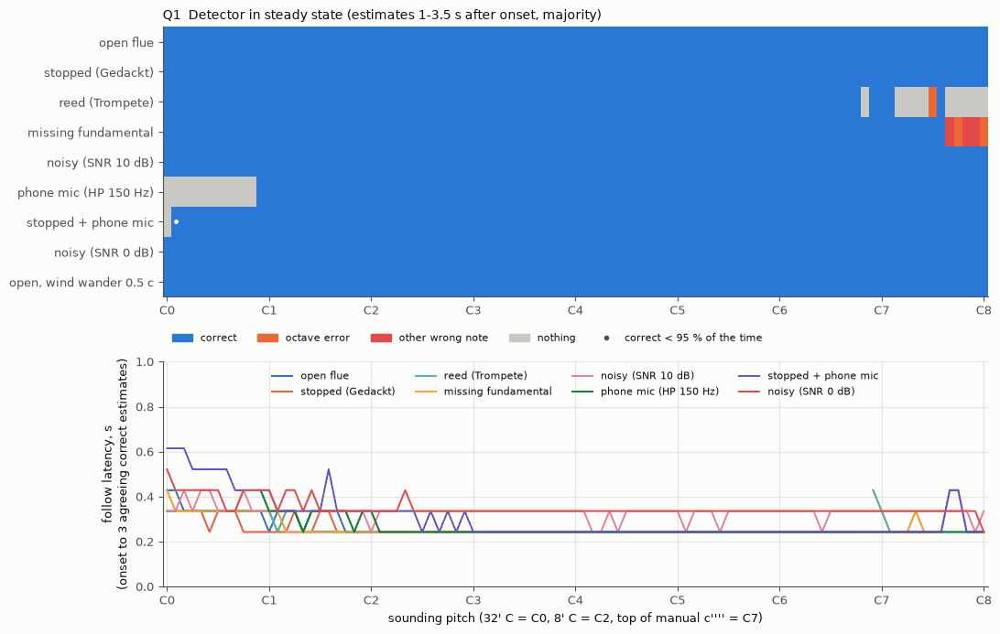

**Steady state, majority of estimates 1-3.5 s after onset:**

- **All correct at all 97 notes (C0-C8):**
  - open flue;
  - stopped;
  - noisy (SNR 10 dB and 0 dB);
  - open flue with wind wander.
- **Failures:**
  - Reed: from A#6 up (aliasing, item 3).
  - Missing fundamental: from G#7 up. Only one partial is left below 9 kHz
    there, so this cannot be fixed.
  - Phone mic: none in the 32' octave C0-A#0.

**Latency:**

- **Follow latency** (from onset to 3 agreeing estimates, TunerTime
  DET_AGREE): median 0.24 s, 0.33-0.43 s below C1 and with noise, worst
  0.62 s (stopped + phone mic at C0).
- **The first estimate** comes 0.05-0.15 s after onset. The rest is
  DET_AGREE x 93 ms.

**With the half-band variant:** reed is correct everywhere; the other
failures are unchanged.

## Q2 Detector frequency error, and length mode's 1-cent criterion

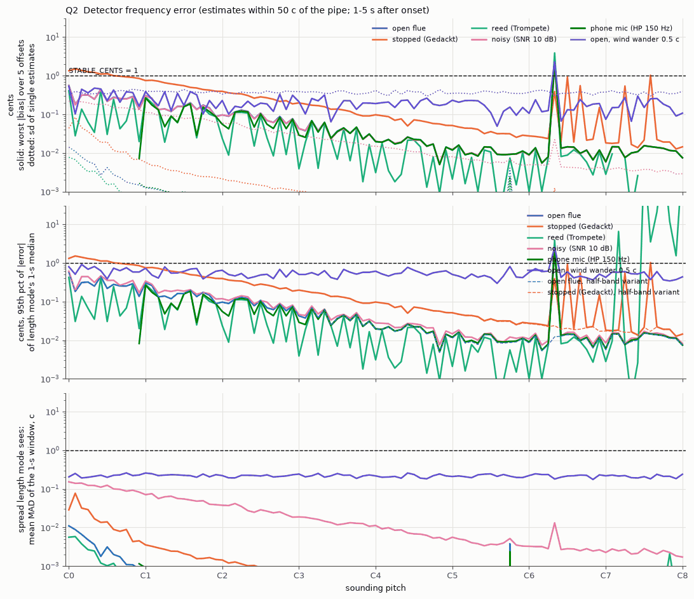

**Rate.** 10.77 estimates/s (22050/2048). A 1-s window holds 10-11 of them,
but they overlap by 75 %, so they are only about 2.7 independent ones.

**Accuracy is set by bias, not by spread.** Without wander, single
estimates scatter by less than 0.02 c. The 1-s median's error p95 is:

| pipe | 32' octave | 16' | 8' | C3-C5 |
|---|---|---|---|---|
| open | <= 0.58 c | 0.31 | 0.13 | 0.07 |
| stopped | 1.52 | 0.76 | 0.40 | 0.20 |

Above that there are alias spikes: 2.2 c at E6 open, and 0.9-1.0 c at
several notes for stopped pipes.

**MAD versus the actual error.** The MAD that STABLE_CENTS tests is 0.00-0.02 c
on these signals, and 0.22 c with 0.5 c wind wander. So the "settled" colour
is shown in 100 % of windows, including the 9 notes per type where the
reading is more than 1 c off.

**What the criterion can and cannot do.** A 1-cent MAD criterion catches
wandering, not bias. With 0.5 c wander the median still moves ±0.4 c (p95)
from window to window. That is good enough for length mode in the tenor and
treble, not in the 16'/32' octaves.

## Q3 Strobe drift (mixture measurement) vs. measurement time

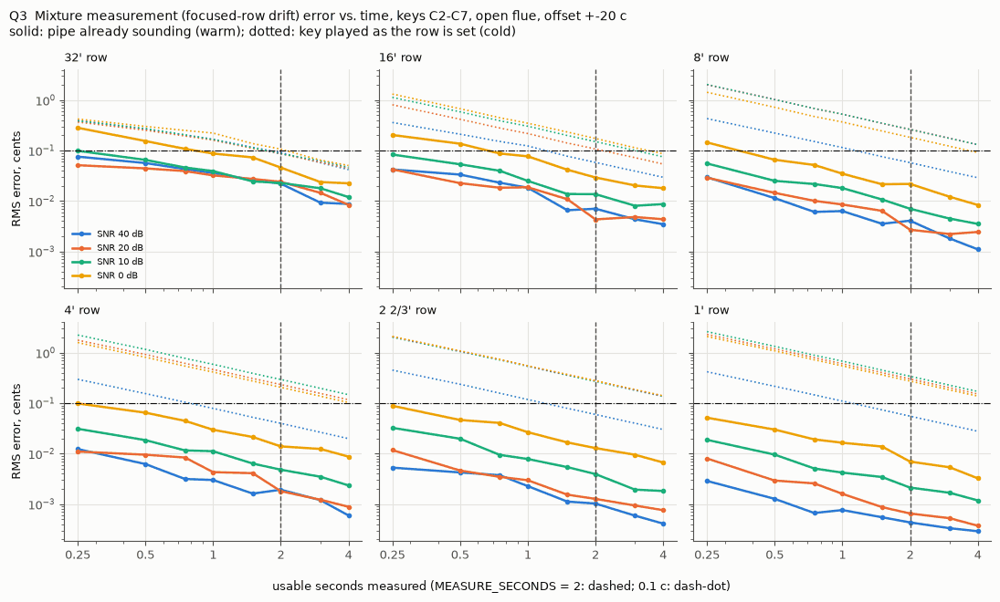
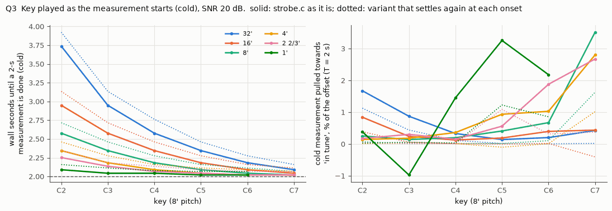
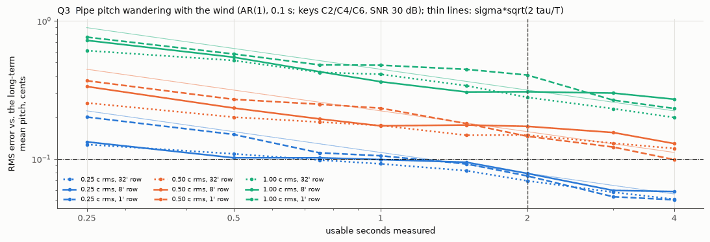
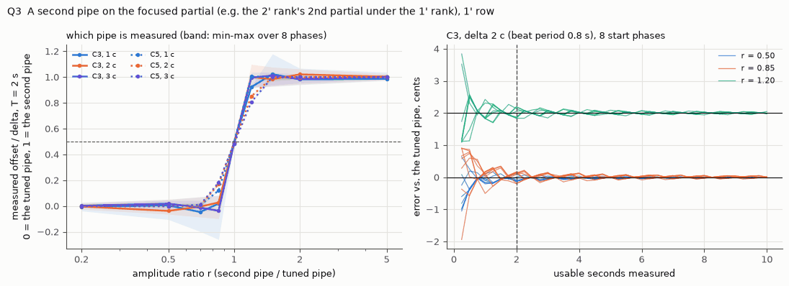
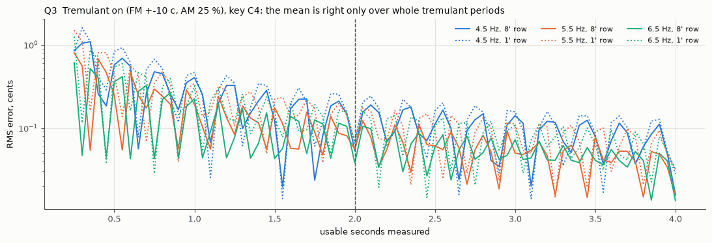
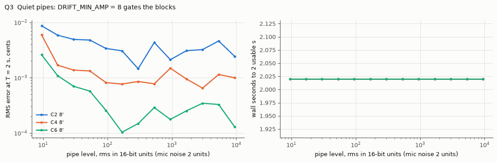

**Pipe already sounding (warm), RMS error at T = 2 s:**

| row | SNR 40 dB | SNR 0 dB |
|---|---|---|
| 32' | 0.022 c | 0.046 c |
| 16' | 0.007 | 0.029 |
| 8' | 0.004 | 0.022 |
| 1' | 0.000 | 0.007 |

At T = 0.25 s it is still <= 0.1 c for all rows above 32' at SNR >= 10 dB.

**Key played as the measurement starts (cold).** Every row is worse, and the
error falls only as 1/T: 8'-1' rows 1.0-1.2 c at 0.5 s and 0.26-0.30 c at
2 s (item 2).

**Wall time to 2 usable seconds:**

- 3.7 s for 32' at C2;
- 2.9 s for 16' at C2;
- about 2.0-2.3 s for 8' and higher.

**Level.** Below about 9 units rms (16-bit), DRIFT_MIN_AMP = 8 lets no block
through and the measurement never ends. Above that, the level makes no
difference.

**Second pipe, wind wander and tremulant:** see items 7-9.

## Q4 Length mode: mm per cent, temperature, meaningful resolution

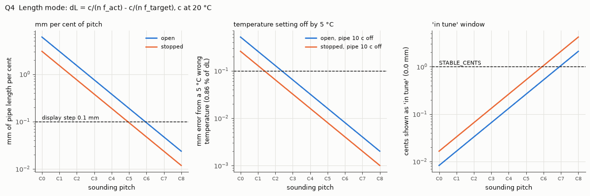
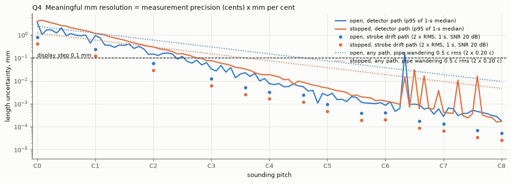

**mm per cent** is L*ln2/1200, with L = c/(n*f):

| pitch | open | stopped |
|---|---|---|
| C0 (32' C) | 6.06 mm/c | 3.03 mm/c |
| C2 | 1.52 | 0.76 |
| C4 | 0.38 | 0.19 |
| C6 | 0.095 | 0.047 |
| C8 | 0.024 | 0.012 |

**Temperature.** A wrong temperature scales dL by c(T±5)/c(T): 0.86 % per
5 °C. For a pipe 10 c off that is at most 0.13 mm at 8' C open, so it does
not matter.

**Meaningful resolution.** Measurement precision times mm/cent gives:

- **Strobe drift path:** below 0.1 mm from about C1 up.
- **Detector path:** above 0.1 mm below about C2 (the bias, Q2).
- **A pipe wandering 0.5 c rms** (most likely the real limit), 2 sigma:
  - 1.2 mm at C2 open;
  - 0.3 mm at C4;
  - 0.08 mm at C6.

## Q5 Other weaknesses: footage rows vs. cut-offs, focus, decimation

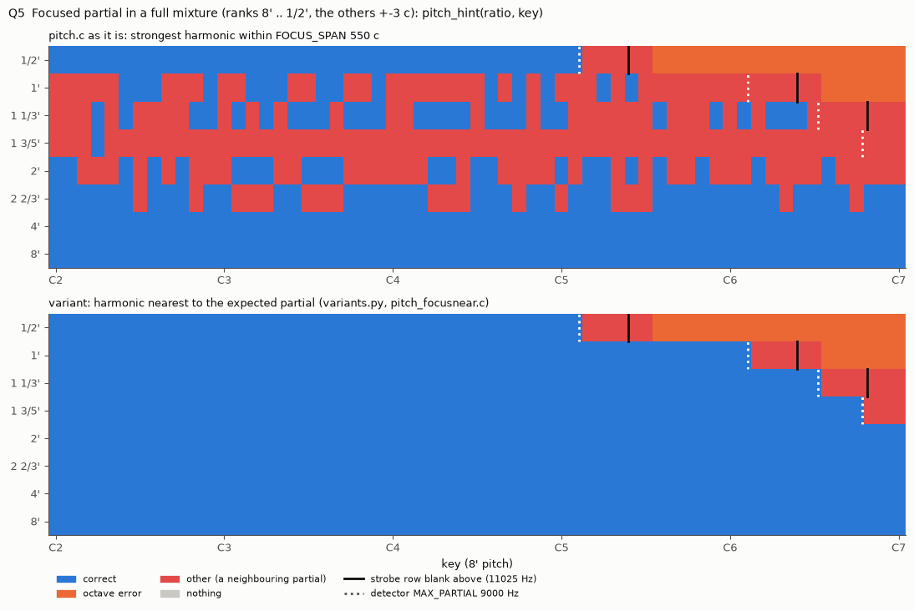
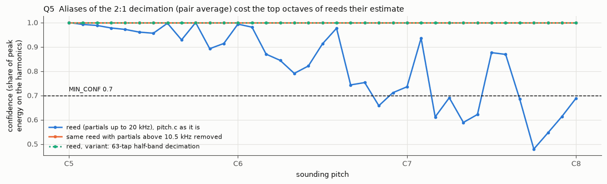

**Three frequency limits do not agree:**

- strobe rows end at 11025 Hz (ORGAN_MAX_FREQ 0.25 x 44100);
- the detector's partials end at 9000 Hz;
- the 2:1 pair average lets aliases from 11-22 kHz through, falling to -6 dB
  only at about 14.7 kHz.

**The focus selection fails throughout the keyboard** for 2 2/3' and higher
in a full mixture.

See items 1, 3 and 4.
